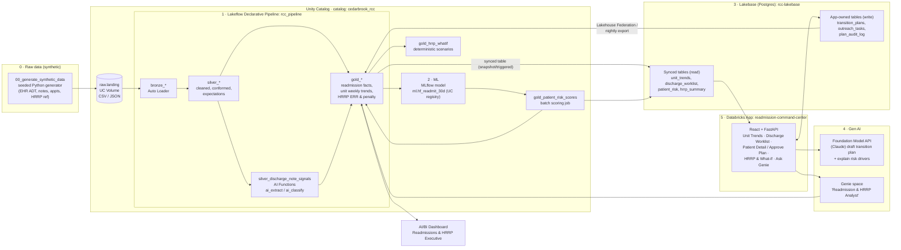

# Readmission Command Center: Solution Architecture

**Customer story:** Cedarbrook Health. Heart-failure 30-day readmissions on Cedarbrook University Medical Center (CUMC) 6 North rose from 14.8% to 23.9% over 20 weeks. The cause is weekend discharges that leave without a booked 7-day follow-up, after the unit lost its weekend transitions pharmacist (2026-06-19) and the HF Bridge Clinic dropped its Friday afternoon slots (2026-06-26). HF is the largest line ($1.14M) of an estimated $1.62M HRRP penalty (HF ERR 1.19).

**Front end:** a Databricks App used by Priya Raman, RN (Manager of Transitional Care), the transitional-care nurses and CHWs, and the Revenue Integrity & Quality team. The app tracks readmission trends by unit, lists discharged patients with their 30-day readmission risk scores, and shows the HRRP penalty exposure with a what-if view.

---

## 1. End-to-end data journey



Each stage reads the previous stage's output, so nothing is siloed. The AI-extracted note signals feed the ML features. The model scores land in gold, sync to Lakebase, and show up in the app. Approvals written in the app flow back into the lakehouse, where Genie and the dashboard can report on them.

---

## 2. Stage-by-stage design

### 2.0 Raw data: synthetic generator
**Notebook:** `notebooks/00_generate_synthetic_data.py`. It is deterministic (`SEED=42`) and writes to `/Volumes/cedarbrook_rcc/raw/landing/<entity>/`.

| File | Grain | Key fields |
|---|---|---|
| `hospitals.csv` | 3 rows | hospital_id, name, beds, CMS CCN |
| `units.csv` | ~18 units | unit_id, hospital_id, unit_name (6 North telemetry, etc.) |
| `patients.json` | ~40k | patient_id, MRN, name, DOB, sex, payer (Medicare FFS flag), zip |
| `encounters.json` | ~120k / 18 months | encounter_id, patient_id, unit_id, admit_ts, discharge_ts, principal_dx (ICD-10), HRRP condition (AMI/HF/PN/COPD/CABG/THA-TKA), DRG, payment, discharge_disposition |
| `discharge_notes.json` | 1 per encounter | encounter_id, note_text (free text with planted phrases like "lives alone, daughter out of state", "instructed to schedule cardiology follow-up next week") |
| `followup_appointments.csv` | ~80k | encounter_id, appt_ts, clinic, booked_before_discharge flag |
| `staffing_events.csv` | handful | unit_id, event_date, description (2026-06-19 pharmacist loss, 2026-06-26 Friday clinic cut) |
| `hrrp_reference.csv` | per condition | expected readmission rate, base payment, peer-group values |

**Planted signal:** after 2026-06-19, 6 North Fri–Sun HF discharges get a booked 7-day follow-up about 18% of the time, against about 69% on weekdays. Readmission probability is driven by: no 7-day follow-up (+), the lives-alone flag (+), age, prior admissions, LOS, and comorbidities. The story numbers are therefore reproducible, and `99_validate_story` checks them.

### 2.1 Lakeflow: ingest
**Pipeline:** `rcc_pipeline` (Lakeflow Declarative Pipelines, serverless, defined in `pipelines/rcc_pipeline.sql` and `.py`)

- **Bronze:** `bronze_<entity>` via Auto Loader (`read_files` / `cloudFiles`) from the volume, with `_ingest_ts` and `_source_file` columns.
- **Silver:** typed and deduplicated tables (`silver_encounters`, `silver_patients`, `silver_followups`, `silver_discharge_notes`) with expectations, for example:
  - `EXPECT (discharge_ts >= admit_ts) ON VIOLATION DROP ROW`
  - `EXPECT (patient_id IS NOT NULL) ON VIOLATION FAIL UPDATE`
- **Silver AI enrichment:** `silver_discharge_note_signals` uses `ai_extract(note_text, ARRAY('caregiver_status','transportation','followup_instruction'))` and `ai_classify(note_text, ARRAY('booked_followup','patient_to_call','none'))`. This creates the `lives_alone_flag`, `transport_barrier_flag` and `followup_instruction_type` columns, which exist only in free text.
- **Gold:**
  - `gold_index_admissions`: HRRP index admissions with `readmit_30d` flag (CMS-style planned-readmission exclusion simplified)
  - `gold_unit_weekly_readmissions`: unit × week × condition rate, with weekday/weekend split
  - `gold_followup_gap`: 7-day follow-up booked % by unit × day-of-week
  - `gold_patient_features`: model feature table (one row per index discharge)
  - `gold_hrrp_condition_err`: ERR by hospital × condition, and `gold_hrrp_penalty` (payment adjustment factor, capped at 3%)

### 2.2 Unity Catalog: governance
- **Catalog** `cedarbrook_rcc`. **Schemas:** `raw` (volume), `bronze`, `silver`, `gold`, `ml`, `app` (federated Lakebase writes).
- **Groups:** `rcc_care_transitions`, `rcc_finance_quality`, `rcc_engineers`, and the app's service principal.
- **PHI controls:**
  - Column tags `phi=true` on name, MRN and DOB.
  - Column mask function `gold.mask_phi()`: full value for `rcc_care_transitions`, otherwise `***`.
  - Row filter `gold.hospital_filter()` driven by a `user_hospital_map` table.
- **Grants:** Finance & Quality get `SELECT` on gold aggregates only. Care transitions get `SELECT` on gold patient-level tables. Only the app SP can write to Lakebase plan tables.
- **Lineage:** captured automatically from volume → bronze → silver → gold → model → scores → synced tables. The evidence export includes a `system.access.table_lineage` query result.
- **Models:** registered in UC (`cedarbrook_rcc.ml.hf_readmit_30d`) with the `@champion` alias.

### 2.3 ML: 30-day readmission risk
**Notebook:** `notebooks/03_train_readmission_model.py`
- **Features:** age, LOS, prior admits (12 months), Charlson-like comorbidity count, discharge weekday/weekend, `followup_7d_booked`, `lives_alone_flag`, `transport_barrier_flag`, unit, payer.
- **Model:** LightGBM (or sklearn HistGradientBoosting), time-based split. It is logged to MLflow with AUC, Brier score, a calibration table and SHAP top drivers, and registered to UC.
- **Scoring:** `notebooks/04_batch_score.py` writes `gold_patient_risk_scores` (score, risk tier, top 3 drivers per patient).
- **What-if:** `notebooks/05_hrrp_whatif.py` is deterministic. It sets the 6 North weekend follow-up rate to 80%, recomputes expected readmissions, and reports avoided readmits (~7), the HF ERR change (1.19 → 1.14) and penalty saved (~$240K). Output goes to `gold_hrrp_whatif`.

### 2.4 Lakebase: operational serving
- **Instance:** `rcc-lakebase`. **Database:** `rcc`.
- **Synced tables** (UC → Postgres, triggered after each scoring run): `unit_trends`, `discharge_worklist` (recent discharges + score + follow-up status + note flags), `hrrp_summary`, `hrrp_whatif`. These serve the app with low latency.
- **App-owned OLTP tables:**
  - `transition_plans(plan_id, encounter_id, draft_text, status[draft|approved|rejected], approved_by, approved_ts)`
  - `outreach_tasks(task_id, encounter_id, assignee, type[book_followup|pharmacist_call|caregiver_check], due_ts, status)`
  - `plan_audit_log`
- **Write-back:** the Lakebase catalog is registered in UC, so `rcc_pipeline` / Genie can join approved plans and completed outreach back to outcomes.

### 2.5 Gen AI
- **AI Functions** run in the pipeline (2.1) and extract note signals.
- **Foundation Model API** (`databricks-claude-*` endpoint), called from the app backend:
  - "Draft transition plan" builds a plan from patient context (risk drivers, note flags, follow-up status) and saves it as a draft in Lakebase. Priya reviews and approves it (human in the loop).
  - "Explain this score" turns SHAP drivers into a short summary in plain language.
- Prompts and responses are logged to MLflow Tracing for evaluation evidence.

### 2.6 Genie agent
- **Space:** "Readmission & HRRP Analyst". **Tables:** `gold_unit_weekly_readmissions`, `gold_followup_gap`, `gold_hrrp_condition_err`, `gold_hrrp_penalty`, `gold_hrrp_whatif`, `gold_patient_risk_scores` (masked), plus federated `transition_plans`.
- **Instructions:** definitions of ERR, readmission and index admission; "weekend = Fri–Sun discharge".
- **Example SQL:** included in the space definition.
- **Sample questions:** "Which unit's HF readmission rate rose most in the last 20 weeks?", "Compare 7-day follow-up booking on weekends vs weekdays for 6 North", "What is the HF penalty and ERR at CUMC?"
- **Access:** embedded in the app through the Genie Conversation API, and also used directly by Finance & Quality.

### 2.7 Databricks App
**Stack:** `app/` uses FastAPI (`backend/`) and React + Vite (`frontend/`), deployed with `app.yaml`. Resources are bound to the app: the SQL warehouse, the Lakebase database, the serving endpoint and the Genie space. Auth runs through the app service principal, with on-behalf-of-user for Genie so UC masks apply.

| Page | Data source | Purpose |
|---|---|---|
| Unit Trends | Lakebase `unit_trends` | Readmission % by unit/week, weekend vs weekday, 6 North highlighted, staffing-event annotations |
| Discharge Worklist | Lakebase `discharge_worklist` | Discharged patients sorted by risk score, follow-up booked?, note flags, create outreach task |
| Patient Detail | Lakebase + FM API | Score, top drivers, note excerpt, "Draft plan" → edit → Approve (writes `transition_plans`) |
| HRRP & What-if | Lakebase `hrrp_summary`, `hrrp_whatif` | Penalty by condition, ERR, slider for weekend follow-up target → avoided readmits/$ |
| Ask Genie | Genie API | Natural-language Q&A |

### 2.8 Dashboard
**`dashboards/readmissions_hrrp_executive.lvdash.json`** (AI/BI). Shows readmission trend by hospital/unit, the follow-up gap heatmap (unit × weekday), HRRP penalty by condition, the what-if savings and model score distribution.

---

## 3. Orchestration & deployment
A **Databricks Asset Bundle** (`databricks.yml`) deploys everything. One job, `rcc_end_to_end`, runs these tasks:

```
generate_data → rcc_pipeline (full refresh) → train_model → batch_score
  → hrrp_whatif → sync_lakebase → validate_story → export_evidence
```

The app, dashboard and Genie space (created through the API in `notebooks/06_create_genie_space.py`) are bundle resources or setup tasks. `databricks bundle deploy && databricks bundle run rcc_end_to_end` rebuilds the whole solution.

---

## 4. Repository layout

```
readmission_command_center/
├── ARCHITECTURE.md
├── README.md                     # quickstart + story + evidence index
├── databricks.yml                # bundle: job, pipeline, app, dashboard
├── resources/                    # job / pipeline / app / lakebase YAML
├── notebooks/                    # committed as .ipynb WITH outputs
│   ├── 00_generate_synthetic_data.ipynb
│   ├── 01_uc_governance.ipynb          # grants, tags, masks, row filters
│   ├── 02_ai_functions_note_signals.ipynb
│   ├── 03_train_readmission_model.ipynb
│   ├── 04_batch_score.ipynb
│   ├── 05_hrrp_whatif.ipynb
│   ├── 06_create_genie_space.ipynb
│   ├── 07_lakebase_setup_and_sync.ipynb
│   └── 99_validate_story.ipynb         # asserts every story number
├── pipelines/rcc_pipeline.sql / .py
├── app/ (app.yaml, backend/, frontend/)
├── dashboards/readmissions_hrrp_executive.lvdash.json
├── genie/space_config.json             # instructions, tables, sample Qs
└── evidence/                           # TEXT execution evidence (see §5)
```

---

## 5. Execution evidence (text only, committed)

The evaluator reads text only, so every stage commits its output as text, not screenshots. `scripts/export_evidence.py` (the last job task) and `scripts/capture_app_evidence.sh` produce:

| Stage | Evidence file | What it shows |
|---|---|---|
| All | `notebooks/*.ipynb` | Notebooks exported **with cell outputs** (`databricks workspace export --format JUPYTER` after the run) |
| Orchestration | `evidence/job_run_rcc_end_to_end.json` | `databricks jobs get-run` output: run_id, task states = SUCCESS, timestamps |
| Lakeflow | `evidence/pipeline_events.md` | Pipeline update ID, rows written per table, expectation pass/fail counts from the event log |
| Unity Catalog | `evidence/uc_governance.md` | `SHOW GRANTS`, `DESCRIBE TABLE EXTENDED` (tags, masks), masked vs unmasked query output, `system.access.table_lineage` rows |
| AI Functions | `evidence/ai_note_signals_sample.md` | 20 note excerpts → extracted flags; readmit rate with/without the lives-alone flag (33.1% vs 20.6%) |
| ML | `evidence/model_metrics.json`, `evidence/mlflow_run.md` | MLflow run ID, AUC, Brier score, calibration table, feature importance, UC model version + alias |
| Scoring | `evidence/risk_scores_sample.csv` | Top 25 scored patients (PHI masked) |
| HRRP what-if | `evidence/hrrp_whatif.md` | Baseline vs scenario: ERR 1.19 → 1.14, ~7 avoided readmits, ~$240K saved |
| Lakebase | `evidence/lakebase_queries.txt` | `psql` output: synced row counts, `SELECT` from `discharge_worklist`, an approved row in `transition_plans` |
| Gen AI | `evidence/llm_transition_plan_samples.md` | Real FM API prompt + response for 3 patients, with MLflow trace IDs |
| Genie | `evidence/genie_conversation.json` | Genie API transcript: question → generated SQL → result rows for 5 sample questions |
| App | `evidence/app_api_responses/*.json`, `evidence/app_deploy.log` | `databricks apps deploy` output, app URL/status `RUNNING`, curl responses from each backend endpoint, `databricks apps logs` excerpt |
| Dashboard | `evidence/dashboard_queries.md` | Dashboard ID, published status, result of each dataset query |
| Story check | `evidence/validate_story.txt` | Assertions (e.g. `6N HF readmit 14.8% → 23.9% ✔`, `weekend FU 18% vs weekday 69% ✔`) |

`README.md` will include an **Evidence Index** that links each requirement (Lakeflow, UC, Lakebase, ML/GenAI, Genie, App) to the evidence file that proves it ran.

---

## 6. Build plan (~6–8 hours)

| Step | Time | Output |
|---|---|---|
| Workspace, catalog, volume, bundle skeleton | 0.5 h | `databricks.yml`, `01_uc_governance` |
| Synthetic generator with planted signal | 1 h | `00_generate_synthetic_data` |
| Lakeflow pipeline + AI Functions | 1.5 h | `rcc_pipeline`, note signals |
| Model train + score + what-if | 1 h | MLflow model, `gold_patient_risk_scores`, `gold_hrrp_whatif` |
| Lakebase instance + synced tables + OLTP tables | 0.5 h | `07_lakebase_setup_and_sync` |
| Genie space + dashboard | 0.5 h | Space + `.lvdash.json` |
| Databricks App (5 pages) + FM API plan drafting | 2 h | `app/` |
| End-to-end run, evidence export, README | 0.5–1 h | `evidence/`, executed notebooks |
