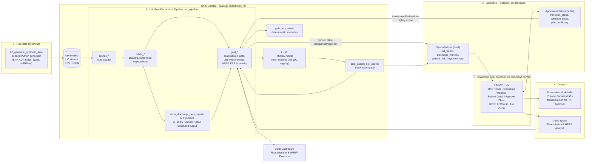

# Readmission Command Center: Solution Architecture

**Customer story:** Cedarbrook Health. Heart-failure 30-day readmissions on Cedarbrook University Medical Center (CUMC) 6 North rose from 14.8% to 23.9% over 20 weeks. The cause is weekend discharges that leave without a booked 7-day follow-up, after the unit lost its weekend transitions pharmacist (2026-06-19) and the HF Bridge Clinic dropped its Friday afternoon slots (2026-06-26). HF is the largest line ($1.14M) of an estimated $1.62M HRRP penalty (HF ERR 1.19).

**Front end:** a Databricks App used by Priya Raman, RN (Manager of Transitional Care), the transitional-care nurses and CHWs, and the Revenue Integrity & Quality team. The app tracks readmission trends by unit, lists discharged patients with their 30-day readmission risk scores, and shows the HRRP penalty exposure with a what-if view.

---

## 1. End-to-end data journey



Each stage reads the previous stage's output, so nothing is siloed. The AI-extracted note signals feed the ML features. The model scores land in gold, sync to Lakebase, and show up in the app. Approvals written in the app flow back into the lakehouse, where Genie and the dashboard can report on them.

---

## 2. Stage-by-stage design

### 2.0 Raw data: synthetic generator
**Notebook:** `notebooks/00_generate_synthetic_data.py`. It is deterministic (`SEED=42`) and writes to `/Volumes/cedarbrook_rcc/raw/landing/<entity>/`.

| File | Grain | Key fields |
|---|---|---|
| `hospitals.csv` | 3 rows | hospital_id, name, beds, CMS CCN |
| `units.csv` | ~18 units | unit_id, hospital_id, unit_name (6 North telemetry, etc.) |
| `patients.json` | ~40k | patient_id, MRN, name, DOB, sex, payer (Medicare FFS flag), zip |
| `encounters.json` | ~120k / 18 months | encounter_id, patient_id, unit_id, admit_ts, discharge_ts, principal_dx (ICD-10), HRRP condition (AMI/HF/PN/COPD/CABG/THA-TKA), DRG, payment, discharge_disposition |
| `discharge_notes.json` | 1 per encounter | encounter_id, note_text (free text with planted phrases like "lives alone, daughter out of state", "instructed to schedule cardiology follow-up next week") |
| `followup_appointments.csv` | ~80k | encounter_id, appt_ts, clinic, booked_before_discharge flag |
| `staffing_events.csv` | handful | unit_id, event_date, description (2026-06-19 pharmacist loss, 2026-06-26 Friday clinic cut) |
| `hrrp_reference.csv` | per condition | expected readmission rate, base payment, peer-group values |

**Planted signal:** after 2026-06-19, 6 North Fri–Sun HF discharges get a booked 7-day follow-up about 18% of the time, against about 69% on weekdays. Readmission probability is driven by: no 7-day follow-up (+), the lives-alone flag (+), age, prior admissions, LOS, and comorbidities. The story numbers are therefore reproducible, and `99_validate_story` checks them.

### 2.1 Lakeflow: ingest
**Pipeline:** `rcc_pipeline` (Lakeflow Declarative Pipelines, serverless, defined in `pipelines/rcc_pipeline.sql` and `.py`)

- **Bronze:** `bronze_<entity>` via Auto Loader (`read_files` / `cloudFiles`) from the volume, with `_ingest_ts` and `_source_file` columns.
- **Silver:** typed and deduplicated tables (`silver_encounters`, `silver_patients`, `silver_followups`, `silver_discharge_notes`) with expectations, for example:
  - `EXPECT (discharge_ts >= admit_ts) ON VIOLATION DROP ROW`
  - `EXPECT (patient_id IS NOT NULL) ON VIOLATION FAIL UPDATE`
- **Silver AI enrichment:** `silver_discharge_note_signals` is an incremental streaming table that calls `ai_query('databricks-claude-haiku-4-5', <prompt + note>, responseFormat => STRUCT<lives_alone_no_caregiver, transportation_barrier, followup_status, evidence>)`. This creates the `ai_lives_alone`, `ai_transport_barrier`, `ai_followup_status` and `ai_evidence` columns, which exist only in free text. Each note is processed once (prompt in `docs/ai_workflow.md`).
- **Gold:**
  - `gold_index_admissions`: HRRP index admissions with `readmit_30d` flag (CMS-style planned-readmission exclusion simplified)
  - `gold_unit_weekly_readmissions`: unit × week × condition rate, with weekday/weekend split
  - `gold_followup_gap`: 7-day follow-up booked % by unit × day-of-week
  - `gold_patient_features`: model feature table (one row per index discharge)
  - `gold_hrrp_condition_err`: ERR by hospital × condition, and `gold_hrrp_penalty` (payment adjustment factor, capped at 3%)

### 2.2 Unity Catalog: governance
- **Catalog** `cedarbrook_rcc`. **Schemas:** `raw` (volume), `bronze`, `silver`, `gold`, `ml`, `app` (federated Lakebase writes).
- **Groups:** `rcc_care_transitions`, `rcc_finance_quality`, `rcc_engineers`, and the app's service principal.
- **PHI controls:**
  - Column tags `phi=true` on name, MRN and DOB.
  - Column mask function `gold.mask_phi()`: full value for `rcc_care_transitions`, otherwise `***`.
  - Row filter `gold.hospital_filter()` driven by a `user_hospital_map` table.
- **Grants:** Finance & Quality get `SELECT` on gold aggregates only. Care transitions get `SELECT` on gold patient-level tables. Only the app SP can write to Lakebase plan tables.
- **Lineage:** captured automatically from volume → bronze → silver → gold → model → scores → synced tables. The evidence export includes a `system.access.table_lineage` query result.
- **Models:** registered in UC (`cedarbrook_rcc.ml.hf_readmit_30d`) with the `@champion` alias.

### 2.3 ML: 30-day readmission risk
**Notebook:** `notebooks/03_train_readmission_model.py`
- **Features:** age, LOS, prior admits (12 months), Charlson-like comorbidity count, discharge weekday/weekend, `followup_7d_booked`, `lives_alone_flag`, `transport_barrier_flag`, unit, payer.
- **Models:** scikit-learn HistGradientBoosting and logistic regression on a time-based split, logged to MLflow (AUC, AP, Brier, top-decile lift, calibration deciles, permutation importance). The higher test AUC is registered to UC as `@champion` (as built: logistic regression, AUC 0.7245).
- **Scoring:** `notebooks/04_batch_score.py` writes `gold_patient_risk_scores` (score, risk tier, top 3 drivers per patient).
- **What-if:** `notebooks/05_hrrp_whatif.py` is deterministic. It sets the 6 North weekend follow-up rate to 80%, recomputes expected readmissions, and reports avoided readmits (~7), the HF ERR change (1.19 → 1.14) and penalty saved (~$240K). Output goes to `gold_hrrp_whatif`.

### 2.4 Lakebase: operational serving
- **Instance:** `rcc-lakebase`. **Database:** `rcc`.
- **Synced tables** (UC → Postgres, triggered after each scoring run): `unit_trends`, `discharge_worklist` (recent discharges + score + follow-up status + note flags), `hrrp_summary`, `hrrp_whatif`. These serve the app with low latency.
- **App-owned OLTP tables:**
  - `transition_plans(plan_id, encounter_id, draft_text, status[draft|approved|rejected], approved_by, approved_ts)`
  - `outreach_tasks(task_id, encounter_id, assignee, type[book_followup|pharmacist_call|caregiver_check], due_ts, status)`
  - `plan_audit_log`
- **Write-back:** the Lakebase catalog is registered in UC, so `rcc_pipeline` / Genie can join approved plans and completed outreach back to outcomes.

### 2.5 Gen AI
- **AI Functions** run in the pipeline (2.1) and extract note signals.
- **Foundation Model API** (`databricks-claude-*` endpoint), called from the app backend:
  - "Draft transition plan" builds a plan from patient context (risk drivers, note flags, follow-up status) and saves it as a draft in Lakebase. Priya reviews and approves it (human in the loop).
  - *(Designed, not built: an "Explain this score" LLM summary. As built, the explanation is the counterfactual drivers shown in the patient view; see §7.)*
- As built, each draft is logged to the Lakebase audit table `app_rcc.plan_audit_log` (model endpoint, prompt SHA-256, latency, approver). MLflow Tracing is a level-up item (see `docs/ai_workflow.md` §4).

### 2.6 Genie agent
- **Space:** "Readmission & HRRP Analyst". **Tables:** `gold_unit_weekly_readmissions`, `gold_followup_gap`, `gold_hrrp_condition_err`, `gold_hrrp_penalty`, `gold_hrrp_whatif`, `gold_patient_risk_scores` (masked), plus federated `transition_plans`.
- **Instructions:** definitions of ERR, readmission and index admission; "weekend = Fri–Sun discharge".
- **Example SQL:** included in the space definition.
- **Sample questions:** "Which unit's HF readmission rate rose most in the last 20 weeks?", "Compare 7-day follow-up booking on weekends vs weekdays for 6 North", "What is the HF penalty and ERR at CUMC?"
- **Access:** embedded in the app through the Genie Conversation API, and also used directly by Finance & Quality.

### 2.7 Databricks App
**Stack (as built):** `app/app.py` (FastAPI) and `app/static/` (JS + Chart.js), deployed with `app.yaml` as a bundle resource. Bound resources: the SQL warehouse, the serving endpoint and the Genie space. Lakebase access is granted explicitly to the app service principal (`scripts/grant_app_access.py`; see §7). The app, including Genie, runs as its service principal, which has the `analyst` entitlement, so UC masks hide PHI in Genie answers.

| Page | Data source | Purpose |
|---|---|---|
| Unit Trends | Lakebase `unit_trends` | Readmission % by unit/week, weekend vs weekday, 6 North highlighted, staffing-event annotations |
| Discharge Worklist | Lakebase `discharge_worklist` | Discharged patients sorted by risk score, follow-up booked?, note flags, create outreach task |
| Patient Detail | Lakebase + FM API | Score, top drivers, note excerpt, "Draft plan" → edit → Approve (writes `transition_plans`) |
| HRRP & What-if | Lakebase `hrrp_summary`, `hrrp_whatif` | Penalty by condition, ERR, slider for weekend follow-up target → avoided readmits/$ |
| Ask Genie | Genie API | Natural-language Q&A |

### 2.8 Dashboard
**`dashboards/readmissions_hrrp_executive.lvdash.json`** (AI/BI). Shows readmission trend by hospital/unit, the follow-up gap heatmap (unit × weekday), HRRP penalty by condition, the what-if savings and model score distribution.

---

## 3. Orchestration & deployment
A **Databricks Asset Bundle** (`databricks.yml`) deploys everything. One job, `rcc_end_to_end`, runs these tasks:

```
generate_data → rcc_pipeline (full refresh) → train_model → batch_score
  → hrrp_whatif → sync_lakebase → validate_story → export_evidence
```

The app, dashboard and Genie space (created through the API in `notebooks/06_create_genie_space.py`) are bundle resources or setup tasks. `databricks bundle deploy && databricks bundle run rcc_end_to_end` rebuilds the whole solution.

---

## 4. Repository layout (as built)

```
readmission_command_center/
├── README.md, ARCHITECTURE.md
├── databricks.yml, resources/rcc.yml, resources/app.yml   # bundle: schemas, volumes, pipeline, 11-task job, dashboard, app
├── src/rcc_datagen.py                 # seeded synthetic EHR generator (story built into the data)
├── pipelines/01_bronze.sql, 02_silver.sql, 03_gold.sql   # Lakeflow (incl. AI Functions)
├── notebooks/                         # job notebooks (source, .py)
│   ├── 00_generate_synthetic_data.py   01_uc_governance.py   02_ai_note_signals_eval.py
│   ├── 03_train_readmission_model.py   04_batch_score.py     05_hrrp_whatif.py
│   ├── 06_genie_space.py               07_lakebase_setup_and_sync.py   99_validate_story.py
│   └── executed/*.ipynb               # same notebooks WITH run outputs
├── app/app.py, app/static/, app/app.yaml   # Databricks App (FastAPI + JS)
├── dashboards/readmissions_hrrp_executive.lvdash.json
├── scripts/                           # local check, evidence exporters, verifiers, app grants
├── docs/                              # deck walkthrough, talk track, AI workflow, FE Bar readiness
└── evidence/                          # TEXT execution evidence (see §5)
```

---

## 5. Execution evidence (text only, committed)

The evaluator reads text only, so every stage commits its output as text, not screenshots. These are the files actually committed:

| Stage | Evidence file | What it shows | Produced by |
|---|---|---|---|
| All notebooks | `notebooks/executed/*.ipynb`, `evidence/notebook_outputs/*.md` | Every job notebook **with its real cell outputs** from job run `601827272748584` (tables rendered as text) | `scripts/export_evidence.py` (decodes `jobs export-run`) |
| Orchestration | `evidence/job_run_summary.md`, `evidence/job_run_601827272748584.json` | Job and task run IDs, result states (11/11 SUCCESS), durations | `scripts/export_evidence.py` |
| Lakeflow | `evidence/pipeline_events.md` | Pipeline updates, rows written per flow, expectation pass/fail, dropped records (event log) | `scripts/export_pipeline_evidence.py` |
| Unity Catalog | `notebooks/executed/01_uc_governance.ipynb`, `99_validate_story.ipynb` | Mask and row-filter functions, tags, masked vs unmasked query output, row filter (3,424 of 14,475), lineage API output | job |
| AI Functions | `notebooks/executed/02_ai_note_signals_eval.ipynb` | Sample extractions with evidence quotes, accuracy/precision/recall vs ground truth, readmit rate by AI flag | job |
| ML | `notebooks/executed/03_train_readmission_model.ipynb`, `04_batch_score.ipynb` | Both models' AUC/AP/Brier/lift, champion selection, calibration deciles, permutation importance, UC registration, scores by tier | job |
| HRRP what-if | `notebooks/executed/05_hrrp_whatif.ipynb`, `evidence/query_results.md` | Penalty by condition; 6N weekend at 80% → 6.52 avoided, ERR 1.14, $238,438 saved | job, `scripts/export_pipeline_evidence.py` |
| Lakebase | `notebooks/executed/07_lakebase_setup_and_sync.ipynb`, `evidence/lakebase_verification.md` | Synced-table creation and `psql` queries; 9/9 synced tables match their UC source (rows, key hash, sum); SP privileges; UC read-back of app writes | job, `scripts/verify_lakebase.py` |
| Gen AI (app) | `evidence/app_api_responses/11_draft_plan.json`, `12_approve_plan.json` | Real Claude plan (model, latency, grounded context), approval and auto-created outreach tasks | `scripts/capture_app_evidence.sh` |
| Genie | `notebooks/executed/06_genie_space.ipynb`, `evidence/app_api_responses/16_genie_ask.json` | Question → generated SQL → result rows for 5 story questions (5/5 COMPLETED); Genie via the app | job, capture script |
| App | `evidence/app_deploy.log`, `evidence/app_api_responses/00_*.json` … `16_*.json`, `evidence/app_logs.txt` | Deploy output, app status, responses from every endpoint, app logs | capture script |
| Dashboard | `evidence/dashboard_verification.md` | Deployed definition read back; all 9 dataset queries executed with results; all 15 widgets resolve their fields | `scripts/verify_dashboard.py` |
| Story check | `notebooks/executed/99_validate_story.ipynb`, `evidence/query_results.md` | 33/33 checks (story numbers + platform objects + governance) | job |

`README.md` has an **evidence index** that maps each requirement to these files.

---

## 6. Build plan (~6–8 hours)

| Step | Time | Output |
|---|---|---|
| Workspace, catalog, volume, bundle skeleton | 0.5 h | `databricks.yml`, `01_uc_governance` |
| Synthetic generator with planted signal | 1 h | `00_generate_synthetic_data` |
| Lakeflow pipeline + AI Functions | 1.5 h | `rcc_pipeline`, note signals |
| Model train + score + what-if | 1 h | MLflow model, `gold_patient_risk_scores`, `gold_hrrp_whatif` |
| Lakebase instance + synced tables + OLTP tables | 0.5 h | `07_lakebase_setup_and_sync` |
| Genie space + dashboard | 0.5 h | Space + `.lvdash.json` |
| Databricks App (5 pages) + FM API plan drafting | 2 h | `app/` |
| End-to-end run, evidence export, README | 0.5–1 h | `evidence/`, executed notebooks |

---

## 7. As built: deviations from the design above

| Design | As built | Why |
|---|---|---|
| `ai_extract` / `ai_classify` | `ai_query('databricks-claude-haiku-4-5', …, responseFormat => STRUCT<…>)` in a streaming table | One call returns all flags plus an evidence quote with a typed schema. The streaming table sends each note to the model once (incremental). |
| LightGBM | scikit-learn HistGradientBoosting **and** logistic regression; the higher test AUC becomes `@champion` | LightGBM isn't preinstalled on serverless. On this synthetic data, logistic regression slightly beat GBM. |
| SHAP drivers | counterfactual drivers: risk drop when a factor is set to its reference value | No extra dependency, and the explanations are actionable ("book follow-up" lowers risk by X pts). |
| React + Vite | FastAPI + vanilla JS / Chart.js (no build step) | Faster to build and deploy for the prototype; same five pages. |
| App Lakebase resource binding | explicit SP grants (`scripts/grant_app_access.py`) | The shared workspace returns PERMISSION_DENIED when binding a Lakebase instance as an app resource. |
| Account groups for masks / row filters | `gold.rcc_user_entitlements` table read by the mask and filter functions | We can't create account groups in the shared demo workspace. |
| Tags `data_classification=synthetic_phi`, `project=…` | `data_classification=RESTRICTED`, `rcc_*` keys | Workspace tag policies restrict allowed values. |
| Job pipeline task `full_refresh: true` | `full_refresh: false` (incremental) | A full refresh re-sends about 16.6k notes to the model (~20 min). Incremental runs take ~2 min. |
| *(added after review)* nurse sees driver labels | **AI nurse briefing** per worklist row (`ai_query`, grounded in the row's drivers) | Reads like a briefing, not a scored table |
| *(added after review)* plan approve / reject only | **Closed loop:** edit metrics → audit log → `gold.plan_feedback` weak labels → `ml.retraining_signals` → MLflow metrics in training | Turns the Lakebase write-back into an active learning signal |
| *(added after review)* one-time Genie story run | **LLM judge** vs SQL reference answers, appended per run to `gold.genie_eval_judgements`, gated in validation | Repeatable quality check |
| *(added after review)* PHI + hospital scope only | **Role-based mask** `gold.mask_clinical_text` on AI evidence quotes (care-transitions only); quotes removed from `gold.index_admissions`; app SP limited to `silver.staffing_events` | Governance beyond PHI and hospital scope |

